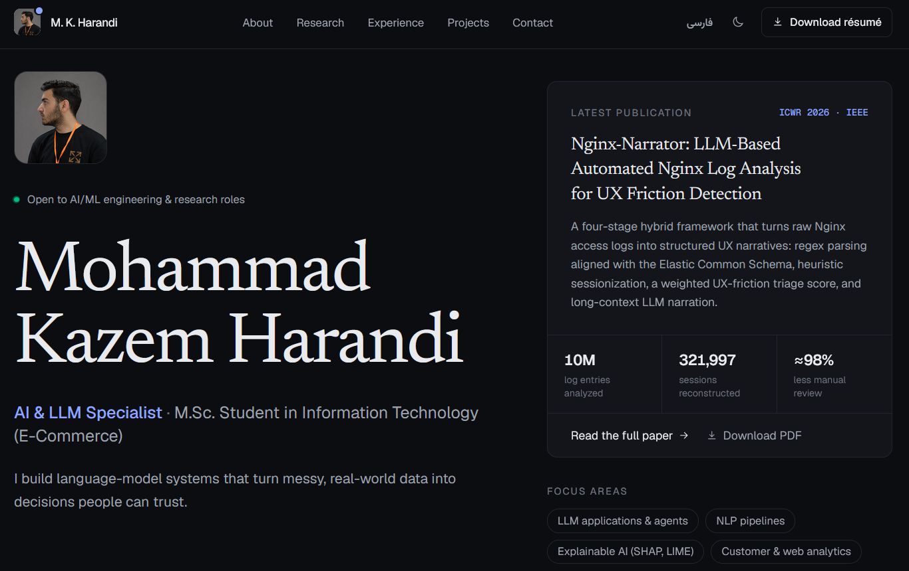

# Mohammad Kazem Harandi — Portfolio

A bilingual developer portfolio built with Vue 3, Vite, and Tailwind CSS v4. One `profile.json` powers the website and generated English and Persian PDF resumes.

## Features

- English and Persian pages, including right-to-left layouts and localized dates.
- Light and dark themes with saved preferences and system theme detection.
- Responsive layouts for desktop and mobile.
- Sections for biography, experience, teaching, projects, skills, achievements, and contact.
- Research publications with PDF links and BibTeX citation copying.
- Markdown articles with dedicated pages, reading time, and previous/next navigation.
- Static HTML generation with Vite SSG, canonical URLs, language alternates, structured data, sitemap, and robots.txt.
- English and Persian PDF resumes generated from profile data, with resume-only overrides and automatic size adjustment.
- Generated social preview image, self-hosted fonts, keyboard navigation, and reduced-motion support.

## Preview



## Run locally

Use Node.js 22 and npm.

```sh
npm ci
npx playwright install chromium
npm run dev
```

Open the local URL printed by Vite. Chromium is used to render resumes and the social preview image; it is not a visitor dependency.

```sh
npm run validate
npm run build
npm run preview
```

The production website is written to `dist/`.

| Command | Purpose |
| --- | --- |
| `npm run dev` | Start Vite; regenerate resumes on startup and when profile.json changes. |
| `npm run validate` | Check profile fields, translations, duplicate IDs, and override references. |
| `npm run build` | Generate PDFs and social image, then pre-render website routes and SEO files. |
| `npm run build:spa` | Build the client application without static page pre-rendering. |
| `npm run preview` | Serve the production build locally. |
| `npm run resume` | Generate resumes and the social preview image. |
| `npm run resume:html` | Also save resume HTML in `.resume-debug/`. |
| `npm run resume:watch` | Regenerate resumes when profile.json changes. |

On Windows PowerShell, use `npm.cmd` and `npx.cmd` if script execution policy blocks `npm` or `npx`.

## Edit the content

Update `profile.json` to change personal details, links, skills, education, work and teaching experience, publications, projects, achievements, and articles. Localized fields use `{ "en": "English text", "fa": "متن فارسی" }`.

Teaching courses support `name`, `instructor`, and `term`. The enclosing teaching entry holds the overall `start` and `end` years.

- `meta`: site URL, languages, calendars, social image, and homepage section order.
- `seo`: default title, description, and keywords.
- `articles`: internal Markdown content or external article links; `draft: true` hides an article from navigation and generated routes.
- `ui`: optional interface-label overrides.
- `resumeOverrides`: content changes applied only to generated resumes. `common` affects every language; `en` and `fa` affect the matching resume.

Put referenced images and publication PDFs in `public/`. Files there are served from the website root.

### Resumes

Existing personal resume PDFs are intentionally excluded from the repository. The generator reads `profile.json`, applies `resumeOverrides`, and writes `public/resume/<fileName>-en.pdf` and `public/resume/<fileName>-fa.pdf`. These are generated artifacts, so `.gitignore` excludes `public/resume/` and `.resume-debug/`.

Normal development and production builds regenerate the PDFs, preserving the website's download links. Keep the generator source in `scripts/resume/` and the shared model in `src/lib/`.

| Environment variable | Purpose |
| --- | --- |
| `CHROMIUM_PATH` | Use an installed Chrome/Chromium executable. |
| `RESUME_STRICT=1` | Fail if PDF generation fails or content cannot fit on one page; recommended for automated builds. |
| `SKIP_RESUME=1` | Skip automatic generation; existing PDFs must be supplied separately if downloads are needed. |

The profile is public website content, including fields used only in resume overrides. Excluding generated PDFs from Git does not make their source data private. Production builds publish downloadable resumes.

## Project structure

```text
profile.json                 Website and resume content
src/components/              Layout, sections, and reusable UI
src/pages/                   Home, article list, article detail, and 404
src/composables/             Profile, locale, theme, SEO, and active section
src/lib/                     Shared localization, formatting, and resume models
src/styles/main.css          Theme tokens and styles
scripts/resume/              PDF and social image generation
scripts/seo.mjs              Static routes, sitemap, robots, and 404 output
scripts/validate-profile.mjs Profile validation
public/                      Images and publication assets
```
